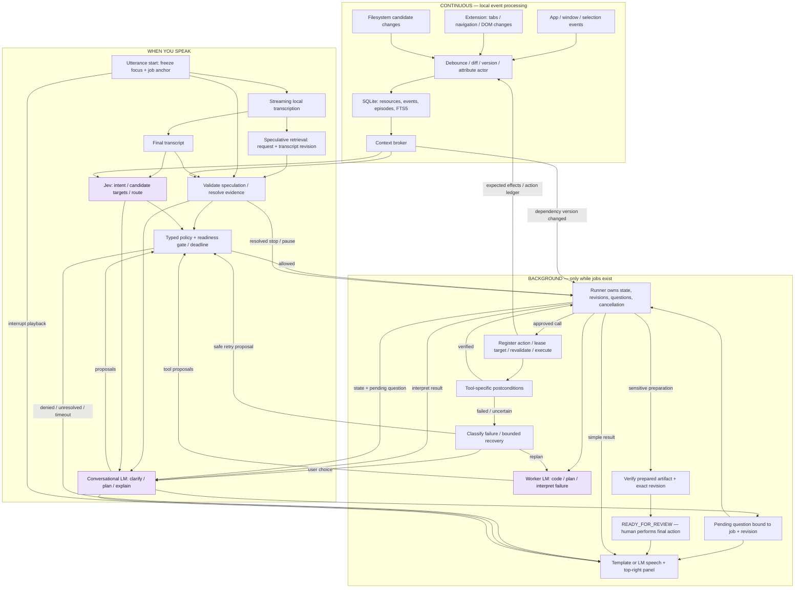

# Architecture

This is the intended architecture. The initial repository increment covers the policy/runner foundation and headless fixtures; live collectors, providers, native UI, and audio remain planned. Purple nodes require inference. Speech recognition and synthesis have separate compute costs.

## Rust-first stack

| Component | Choice | Boundary |
|---|---|---|
| Service and coordinator | Rust + Tokio | Cancellation tokens, bounded queues, request deadlines; separate native UI main thread |
| Typed data and protocol | Serde, explicit Rust enums | Versioned messages and exhaustive result types |
| State and search | SQLite through rusqlite, FTS5 | Runner is job-state writer; transactions for revisions; database work off async executor |
| File observation | notify, macOS FSEvents backend | Events mark dirty candidates; rescan after gaps; no full hashing on every request |
| Native observation and panel | objc2 / AppKit bindings | NSWorkspace and accessibility observers; top-right nonactivating panel |
| Browser adapter | Small JavaScript Manifest V3 extension + Rust Native Messaging host | Extension is the deliberate non-Rust edge; structured permitted DOM text, no screenshot capture |
| Provider transport | reqwest | TypeSafe Jev endpoint and Crusoe OpenAI-compatible inference endpoint |
| Audio | cpal + whisper-rs; native macOS speech output | Push-to-talk first; local model file; wake-word engine later |
| Diagnostics | tracing with redaction | Request/job/tool spans, timings, reason codes; no content dumps by default |

Do not pull every planned dependency into the foundation before using it. Native permission and voice integration are substantial work; feature-gate platform-specific adapters so headless tests run independently.

## Parallelism and inference boundaries

1. Collectors independently process events while the model is idle. Extraction is bounded, prioritized and deferred for expensive inputs. The initial scope is text/Markdown, not PDF OCR.
2. During speech, provisional transcript revisions launch cancellable read-only retrieval. No partial transcript authorizes effects.
3. After final speech, Jev routing and target/evidence resolution run concurrently. Jev sees compact metadata, preferences, the frozen anchor, and supported capabilities. The conversational model gets selected evidence and history appropriate to its task.
4. The gate waits for each tool's declared evidence requirements, not an unrestricted Jev prediction. Low confidence or unresolved arguments lead to clarification; timeout is explicit.
5. Simple actions return verified template acknowledgments with no conversational call. The LM handles ambiguity and reasoning. Independent workers can proceed while conversation remains responsive.
6. Later observations do not mutate an in-flight model input. They increment resource/job revisions and enter at a tool boundary or next model call.

No background semantic summarization is required. Optional episode summaries are derived evidence with source links, never authoritative replacements for observations.

## Evidence, history and provenance

A resource record holds stable ID, version, content hash, observed time, freshness and source. Events reference old/new versions rather than duplicating full contents. Activity episodes are provisional groupings; viewing a page does not prove agreement with its content.

Every retrieved item preserves source and trust labels. User speech, configured preferences, observed application text, and model inference are different classes. Proposed arguments reference supporting evidence. The gate checks those references against original records; the model cannot self-certify authorization. A page can supply an address but cannot authorize payment.

Before acting, the runner writes an action ledger entry: action ID, job/request ID, actor, target, expected base version and effects. Correlate resulting OS events using adapter IDs where available and target/timing/version otherwise. Attribution can be `User`, `Agent(action_id)`, or `Unknown`; ambiguous events remain unknown. Expected worker writes still update shared resource state but do not blindly re-trigger the same action. Unexpected writes pause affected jobs.

A frozen utterance anchor records actual focus, selection, target ownership and active conversational jobs. If an agent changed focus or multiple jobs match “that,” clarify. Background workers should use job-owned tabs; leases serialize Jarvis's actions but cannot lock out the human.

## Runner, clarification and recovery

The runner is the sole owner of job state. Models emit proposals. A job references its originating request, current revision, dependencies, pending question, attempts, cancellation state and result artifacts. Corrections update the revision and invalidate stale proposals. Pending questions are bound to job/revision; ambiguous answers are not assigned arbitrarily.

Suggested state vocabulary: queued, running, awaiting clarification, paused conflict, recovering, ready for review, completed, cancelled, failed, outcome unknown. State transitions must be checked rather than free-form string writes.

| Condition | Policy |
|---|---|
| Transient read failure | Bounded retry with cancellation/deadline; then surface blocker |
| Stale element or resource | Refresh and resolve again; recheck before acting |
| User edits worker's write target | Pause; do not overwrite or auto-rebase silently |
| Read dependency changes | Mark stale; evaluate before committing output |
| External action outcome unknown | Reconcile observable state before any retry |
| No result meets constraints | Ask whether to change constraints; never silently relax them |
| User starts speaking | Stop speech immediately; background jobs continue unless told otherwise |
| “Stop that” | Resolve job; stop queued work and cooperatively cancel running work; do not claim completed effects were undone |
| Repeated failure without new evidence | Exhaust bounded recovery budget and report blocker |

## Ready-for-review is an enforced terminal boundary

Sensitive capabilities expose preparation only: `PrepareMessage`, `PreparePurchase`, `PrepareBooking`, `PrepareDeletionReview`. There are no final send/pay/book/delete tools in the model-facing registry. Generic browser clicks, form submissions, shell commands or scripts must not offer a bypass. Initial browser execution should therefore use a narrowly supported adapter and fixture, not arbitrary unrestricted page scripts. Coding tools are confined to a selected workspace and approved test commands; confinement requires an actual enforcement mechanism, not a prompt.

Flow:

1. Resolve user intent, recipient/target and constraints, asking when necessary.
2. Gate permits preparation only, with exact job revision and target.
3. Tool prepares an unsent draft, review checkout, or deletion manifest.
4. A verifier reads the result back and compares it to the latest constraints.
5. Record artifact ID/location, content digest/revision, request/job revision, verification evidence and `final_action_executed = false`.
6. Enter `READY_FOR_REVIEW` only after verification. Failure or uncertainty is a blocker, not ready.
7. Show persistent Review action and say “The draft is ready for review. It hasn't been sent.” Open the exact artifact only when requested, without stealing focus during preparation.
8. On a relevant change, invalidate review readiness and reverify. If the human has already completed the action, record only what can be independently observed.

For deletion, prepare a list with paths, identities and versions; do not move items to Trash as “preparation.” For checkout, check whether earlier steps create holds or other side effects; unsupported sites remain research-only. A generic local artifact proves the internal contract, not a real provider's unsent-draft or purchase behavior.

## Browser bridge and privacy

The extension uses a persistent Native Messaging connection to a Rust host. Allow only the installed extension ID in the host manifest. The native host connects to the service over an owner-only local socket; the service checks peer/user ownership and a per-install pairing secret. Use a versioned handshake, per-connection nonce, monotonic message sequence, bounded message size, request IDs and timeouts. Reject unknown protocol versions, replayed/stale messages and unauthorized target IDs. Avoid an unauthenticated localhost HTTP action endpoint. Tokens never enter page scripts.

Content scripts run only on explicitly approved origins, extract relevant text, omit sensitive form values, and never collect private-window activity. DOM changes mark regions dirty; normalized text diffs ignore cosmetic churn. Suspended/disconnected tabs become stale; missed events require reconciliation.

Proposed configurable retention: raw observations 24 hours; derived episodes 7 days. These are privacy defaults to implement and test, not claims about current code. Persist explicit preferences and active job evidence only as necessary; redact expired source content from derived records too. Pause disables collection, and Delete history removes persisted evidence and associated search entries. Do not index credentials, password fields, hidden form contents, private windows, or excluded paths. Verify path containment after symlink resolution. Local processing does not imply that selected context stays local: provider calls transmit the chosen evidence and must respect exclusions.

## Panel

A nonactivating top-right panel reflects runner/audio/service state: steady “Jarvis on,” waveform “Listening,” dots “Thinking,” spinner plus concrete worker activity, stable clarification card, blocker reason, persistent Review card, brief completed checkmark, explicit paused state. Awareness-on is visually different from microphone capture. Controls: pause awareness, mute speech, cancel selected job, expand evidence, open review artifact. All state changes are event-driven; decorative animations cannot imply unverified success.
